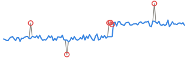
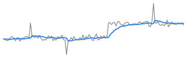
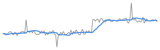

# Safe Filters for Home Assistant

[](https://hacs.xyz/docs/faq/custom_repositories)
[](https://github.com/bardagi/ha-safe-filters/actions/workflows/validate.yml)
[](https://github.com/bardagi/ha-safe-filters/actions/workflows/tests.yml)

A helper that turns **one sensor, or several combined**, into **one trustworthy value**. It ignores readings that are unavailable, stale, out of range or obviously wrong. It smooths the result with time-based filters and survives restarts without garbage readings.

It replaces a YAML `filter` sensor for a single noisy sensor, and chains like `min_max` → `filter` → `statistics` for several, with one helper you set up in the UI.

```
sources ──► validate each ──► enough valid? ──► combine ──► spike     ──► rate  ──► EMA over  ──► EMA over  ──► moving  ──► round
            (unavailable,     (else hold last   (min/max/    rejection     limit    time          readings      average
             range, stale,     value, then       mean/median/                       (low-pass)
             deviation, unit)  unavailable)      weighted/priority)
```

## Why

| Problem with the usual YAML chain | What Safe Filters does |
|---|---|
| `min_max` keeps using a dead sensor's last value forever. | Sources that are `unavailable` are always ignored. Optionally, *Stale after* also ignores a source that has stopped reporting but kept its last value. |
| One glitching sensor (e.g. -40 °C on a low battery) wins `min`. | Range limits, plus *max deviation* from the median of the other sources. |
| `median` of two sensors is just the average, so it rejects nothing. | Validation works per source, whatever the combine method. |
| The `lowpass` filter's time constant counts *samples*, not minutes. | The low-pass (an exponential moving average over time) and the moving average use real elapsed time. If you do want to count readings, the EMA over readings counts only valid ones. |
| `precision` on every filter step rounds intermediate values (stair-steps). | Rounding happens only on the final value. |
| The order of chained filters is easy to get wrong. | Fixed, safe order; every stage is optional. |
| After a restart the chain starts empty and shows wrong values. | The value **and the filter state** are restored. During startup the restored value is shown until Home Assistant has started and the sources are back. |

## Installation

### HACS (custom repository)

Safe Filters is not in the HACS default store. Add it as a custom repository:

1. HACS → ⋮ → **Custom repositories**.
2. Add `https://github.com/bardagi/ha-safe-filters`, category **Integration**.
3. Install **Safe Filters** and restart Home Assistant.

### Manual

Copy `custom_components/safe_filters` into your `config/custom_components/` folder and restart.

Requires Home Assistant 2025.8 or newer. The integration icon is shipped with the integration and is shown from Home Assistant 2026.3.

## Setup

**Settings → Devices & services → Helpers → Create helper → Safe Filters**, then choose:

- **Filter one sensor**: validate and smooth a single sensor. A bad reading is ignored and the last good value is held instead.
- **Combine several sensors**: merge several sensors into one value, leaving out the ones that can't be trusted.

Every option except this choice can be changed later from the helper's **Configure** button.

### 1. Sources

| Option | Description |
|---|---|
| Source sensor(s) | `sensor`, `number` or `input_number` entities. When combining, drag to reorder; with *Priority*, the first valid one is used. Units are converted automatically when possible (°F → °C, mbar → hPa, …). |
| Combine method | Combine only: `min`, `max`, `mean`, `median`, `weighted_mean`, `priority` (first valid source). |

With `weighted_mean`, an extra step asks for a weight per source. Weights are relative (50/30/20 is the same as 5/3/2) and are renormalised over the sources that are valid at the time: if the 50 drops out, the 30 and 20 count 60 % and 40 %. The same step has two optional settings:

| Option | Default | Description |
|---|---|---|
| Minimum valid weight | 0 % (off) | The valid sources must together carry at least this share of the total weight, otherwise the last value is held (then unavailable). With 50/30/20 and 50 %, the 50 alone or the 30 and 20 together are enough, but the 20 alone is not. Applies in addition to *Minimum valid sources*. |
| Offset learning time | 0 min (off) | Renormalising removes a dead source's value, but not its influence: if it read 1 °C above the others, the result drops by its share when it goes away. With this on, the helper learns how far each source usually is from the combined value while all sources are valid, and corrects for it when one drops out, so the value doesn't jump. The time sets how quickly the learned offsets follow changes; 60 min is a good start. If a source's real offset changes while it is gone, the value steps by that change when it comes back. |

A source that dies without becoming `unavailable` (common for battery Zigbee and BLE sensors) keeps counting with its last value. Use *Stale after* for such sources if they report regularly.

### 2. Data quality

| Option | Default | Description |
|---|---|---|
| Lowest / highest plausible value | – | Readings outside this range are ignored. |
| Stale after | 0 (off) | A `sensor` that hasn't reported for this long is ignored. Only turn this on for sources that send their value regularly even when it doesn't change. Many integrations, such as ESPHome and MQTT, only send changes, so a steady value would look like a dead device (in ESPHome, `force_update: true` makes a sensor re-send unchanged values). Not applied to `number`/`input_number`. |
| Max deviation | – | Combine only. With ≥ 3 valid sources, ignore a source further than this from their median. |
| Minimum valid sources | 1 | Combine only. Fewer valid sources than this = no new value. |
| Hold last value for | 30 min | When there is no valid reading (or too few valid sources), keep showing the last good value (status `holding`), then become `unavailable`. While it is held, the time-based filters keep settling toward it. Also limits how old a value restored after a restart may be. |

### 3. Filters (applied in this order)

| Stage | Settings | Notes |
|---|---|---|
| 1. Spike rejection | window (samples), max distance from median | A sample further than this from the window's median is ignored. A real, lasting change gets through after about half a window. |
| 2. Rate limit | max change per minute | Clamps how fast the value may move. Must be greater than 0. |
| 3. Exponential moving average over time (low-pass) | time constant (min) | Exponential smoothing on real time: after one time constant the output has moved ~63 % toward a new level, however often the sources report. Between reports, and while the last value is held, it keeps moving toward the last valid reading. |
| 4. Exponential moving average over readings | readings N | Each new valid reading moves the output 2/(N+1) of the way toward it (N = 5: a third). A repeat of the same value counts too. Time plays no part, so if the source goes quiet the output stays where it is: for sources that only send changes, use the EMA over time. |
| 5. Moving average | window (min) | Time-weighted average. |
| Decimals | default 1 | Rounding of the final value only. |

Each smoother (3–5) adds delay. Usually *one* of them is enough.

Each chart shows one filter on its own, applied to the same noisy example: grey is the input, blue the output, red rings are samples ignored by spike rejection. The same charts are shown in the setup dialog.

| 1. Spike rejection | 2. Rate limit |
|---|---|
|  |  |
| **3. EMA over time (low-pass)** | **4. EMA over readings** |
|  |  |
| **5. Moving average** | |
|  | |

## Attributes

| Attribute | Meaning |
|---|---|
| `status` | `ok`, `holding` (no valid reading or too few valid sources, showing the last good value) or `restored` (value from before a restart, waiting for fresh data). |
| `valid_sources` | Number of sources used right now (0 or 1 when filtering one sensor). |
| `combined_value` | Value before filtering: the combined value (corrected for missing sources when *Offset learning* is on), or the source's own value when filtering one sensor. |
| `sources` | Per source: converted value and status (`ok`, `unavailable`, `non_numeric`, `unit_mismatch`, `out_of_range`, `stale`, `deviation`). With `weighted_mean` also `share`: the % of the combined value it makes up right now (0 when not used). With *Offset learning* also `offset`: how far it usually is from the combined value. |

`valid_sources`, `combined_value` and `sources` are excluded from the recorder. To avoid a new state (and recorder row) on every source report, the state is written right away only when the value, `status`, availability or a source's status changes. Changes to `combined_value` and the per-source values alone are written at most once a minute.

The sensor has `state_class: measurement` (`total` for energy, gas, water and monetary sources, which Home Assistant doesn't allow as `measurement`), so long-term statistics work. For values like "min/max last 24 h" or "change last hour", add a built-in **Statistics** helper on top of the safe filter.

## Recommended setups

These are starting points. Adjust them to your sensors and how often they report. A few rules apply to all of them:

- **Range:** wide enough for real extremes, narrow enough to catch typical glitches like -40 °C on a low battery, or 0.
- **Stale after:** only for sources that send their value regularly even when it doesn't change. Set it to 2–3 × their longest normal interval. It applies to every source, so it has to suit the slowest one.
- **Smoothing:** one smoother (low-pass, EMA over readings *or* moving average) is usually enough. Low-pass below means the exponential moving average over time. Keep it short when an automation has to react quickly.

### Choosing a combine method

| Method | Use when | Example |
|---|---|---|
| `median` | 3 or more similar sensors, any one of which may be wrong. | Several temperature sensors in one room. |
| `mean` | 2 similar sensors, or several that are equally good. | Two pressure sensors. |
| `weighted_mean` | All sources should count, but some are more accurate or better placed. Or a fallback should only step in when the others are gone. | One good sensor and two cheap ones; the average temperature of the whole home. See [Weighted mean examples](#weighted-mean-examples). |
| `min` | Errors only push the reading up. | Outdoor temperature, when some sensors get sun. |
| `max` | Errors only push the reading down. | Brightness: shade, dirt and snow only lower it. |
| `priority` | One source is preferred, and the others measure the same thing the same way, so switching doesn't cause a jump. | A local meter reader with a cloud backup. |

### Indoors

**Several temperature sensors in one room**
- Method `median` (with only two sensors, `mean`); range 0 to 40 °C.
- Max deviation 1.5 °C: with three or more sensors, this leaves out one that sits in the sun, above a radiator or by an open window, until it reads normally again.
- If the sensors send their value regularly even when it doesn't change: stale after 2–3 × that interval.
- Moving average 10 min (or low-pass 5 min). Decimals 1.
- If one sensor is better placed than the others, use `weighted_mean` instead (see [Weighted mean examples](#weighted-mean-examples)).

**Bathroom humidity for a fan**
- **Filter one sensor**; range 0 to 100 %.
- No spike rejection or rate limit: a shower raises the humidity quickly, and that is what the fan should react to.
- Low-pass 1 min, or none. Decimals 0.

**A noisy single sensor (e.g. CO₂ or power)**
- **Filter one sensor**; set a plausible range (e.g. 300 to 5000 ppm).
- Spike rejection: window 5, radius sized to a believable jump. Low-pass 2–5 min. Decimals 0.

### Outdoors

**Temperature from several sensors, some of which get sun**
- Method `min` (the shaded sensor wins); range -55 to 45 °C; minimum valid sources 2.
- If the sensors send their value regularly even when it doesn't change: stale after 90 min.
- Spike rejection: window 5, radius 2.5. Low-pass 5 min. Decimals 1.
- Use *max deviation* only if all sensors are placed similarly: in strong sun, a correctly shaded sensor can be the odd one out.

**Air pressure from several sensors**
- Method `median` with three or more sensors, `mean` with two; range 930 to 1070 hPa.
- All sources must report the same kind of pressure. Weather stations usually report sea-level (relative) pressure. Bare sensor chips such as the BME280 report absolute pressure, which is about 12 hPa lower per 100 m of altitude. For absolute pressure, lower both range limits by the same amount.
- Max deviation 3 hPa (three or more sensors) leaves out a sensor that reports the other kind, or has failed.
- Spike rejection: window 5, radius 2 hPa. Moving average 15 min (30 min for sensors outside in the wind). Optional rate limit 0.5 hPa/min. Decimals 1.
- Pressure is almost the same indoors and out, so any pressure sensor in the house can be a source. Sensors at different heights differ by about 0.12 hPa per metre (0.4 hPa per floor). With `mean` or `median` the value steps by part of that when one drops out. `weighted_mean` with equal weights and offset learning 60 min avoids the step.

**Humidity from 3–4 sensors**
- Method `median`; range 0 to 100 %; max deviation 15; minimum valid sources 2.
- Moving average 10 min. Decimals 0.

**Brightness from several sensors**
- Method `max`: a sensor in shade, behind dirt or under snow reads too low, never too high. Range 0 to 120 000 lx.
- No spike rejection: sudden changes in light are real.
- Low-pass 2 min, so blinds don't react to every passing cloud. Decimals 0.

**Wind speed from one sensor**
- **Filter one sensor**; range 0 to 75 m/s; low-pass 3–5 min.

### Weighted mean examples

Use `weighted_mean` when every source should count, but not equally. `median` treats all sources the same and leaves out the odd one; `priority` uses one source at a time and jumps when it switches. Weights are relative and are shared out among the sources that are valid right now (see [Sources](#1-sources)).

**One accurate sensor and a few cheap ones**
- Weights 4 / 1 / 1: the accurate sensor makes up 67 % of the value, each cheap one 17 %.
- Offset learning 60 min. Cheap sensors are often a bit off. Without it, the value jumps to their error when the accurate sensor drops out.
- Minimum valid weight 0 % to carry on with the cheap sensors alone, or 50 % to hold the last value instead.
- Leave max deviation off, or set it wide. It compares against the plain median and ignores the weights, so two cheap sensors that agree can outvote the accurate one.

**Average temperature of the whole home, weighted by floor area**
- One sensor per room, with the room's floor area in m² as its weight, e.g. living room 35, kitchen 15, bedroom 14, office 10, bathroom 6.
- Offset learning 120 min. The rooms differ on purpose (a cool bedroom, a warm bathroom), so without it the average jumps whenever one room's sensor drops out.
- Minimum valid weight 50 %: if rooms making up more than half the floor area are missing, hold the last value rather than report an average of what's left.
- No max deviation: the rooms are supposed to differ.
- Moving average 15–30 min. Decimals 1. Useful for heat pump curves, ventilation and energy dashboards.

**Room temperature for heating, with the radiator thermostat as a last resort**
- Room sensors weight 1 each; the radiator thermostat's own temperature sensor weight 0. A source with weight 0 is only used when every source with a weight is invalid.
- Offset learning 60 min. The thermostat sits by the radiator and usually reads warm; the learned offset corrects for most of that when it has to take over.
- Minimum valid weight must stay 0 %. The thermostat carries no weight, so any higher value would stop it from taking over.
- Leave max deviation off: the thermostat reads differently by design, and a source left out for deviation doesn't get its offset learned.
- The same works outdoors: a temperature sensor from a weather service at weight 0 keeps the value going when your own sensors are down.

### A backup source with `priority`

**Power from a local meter reader, with a cloud integration as backup**
- Method `priority`, local reader first. Both read the same meter, so switching between them doesn't cause a jump.
- Range sized to the main fuse, e.g. 0 to 25 000 W; with solar export, a negative lower limit.
- No filters: the value should follow the meter. Decimals 0. Hold last value for 5 min.
- Stale after applies to both sources, so set it longer than the cloud integration's update interval, or leave it off.

## Development

```bash
uv sync                      # Home Assistant, test harness, ruff, ty, prek
uv run prek install          # run the checks below on every commit
uv run prek run --all-files  # ruff, ty, uv lock, translations/version/brand checks, file hygiene
uv run pytest                # all tests; on native Windows only the engine tests
```

The Home Assistant test harness doesn't run on native Windows. Use WSL or CI for the integration tests in `tests/ha/`.

The processing logic lives in `custom_components/safe_filters/engine/` and has no Home Assistant imports. `sensor.py` and `config_flow.py` are thin glue around it. The code must stay compatible with Python 3.13 (Home Assistant 2025.8), which is why ruff and ty target 3.13.

**Icon:** `assets/icon.svg` is the source. After editing it, run `uv run python scripts/render_brand.py` (the pre-commit hook does this) to regenerate `custom_components/safe_filters/brand/icon.png` and `icon@2x.png`.

**Filter charts:** the charts in `custom_components/safe_filters/charts/` are generated by `scripts/render_filter_charts.py`. It runs the real filter stages from `engine/stages.py` on a fixed noisy example. The pre-commit hook re-runs it when the stages change. The config flow embeds the charts as data URIs in the filter descriptions.

**Releasing:** bump `version` in both `manifest.json` and `pyproject.toml` (a hook checks they match), commit, then `git tag v0.2.0 && git push --tags`. The release workflow checks the tag against the manifest and publishes a GitHub release, which HACS offers as an update.

## License

MIT
